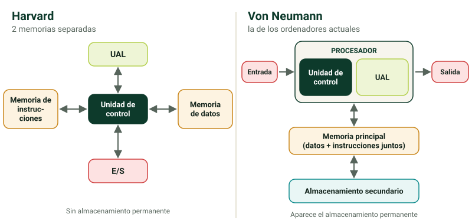

## ¿Qué es un sistema informático? {alta}

Un **sistema informático** es cualquier dispositivo electrónico en el que interactúan **tres componentes**:

1. **Hardware**: la parte **física**, lo que se puede tocar (pantalla, teclado, RAM, procesador…).
2. **Software**: la parte **lógica**, lo que no se puede tocar: los programas.
3. **Usuarios**: sin ellos, el hardware y el software no sirven de nada.

Ejemplos: móviles, tablets, consolas, Smart TV, neveras inteligentes… y el más extendido, el **ordenador**.

> [!clave] Un **ordenador** es un **sistema digital binario** que procesa instrucciones o datos que recibe de dispositivos de **entrada** y muestra los resultados en dispositivos de **salida**.

Todo sistema sigue siempre tres pasos, y en este orden: **Entrada → Procesamiento → Salida**.

> [!ejemplo] Doble clic en un acceso directo (**entrada**) → el sistema operativo ejecuta el programa y crea su proceso (**procesamiento**) → lo ves en pantalla (**salida**).

### Por qué el ordenador es binario {media}

Dentro del ordenador todo son combinaciones de **0 y 1**. No es que haya ceros y unos literalmente: el **1** es que **hay corriente eléctrica** (encendido) y el **0** que **no la hay** (apagado). De ahí sale el símbolo del botón de encendido.

**Informática** = **infor**mación + auto**mática**: el tratamiento automático de la información.

```test
¿Cuáles son los tres componentes de un sistema informático?
+ Hardware, software y usuarios
- Hardware, software y red
- Procesador, memoria y disco duro
- Entrada, procesamiento y salida
= Sin usuarios, el hardware y el software no sirven de nada.

Haces doble clic en un acceso directo y el programa aparece en pantalla. ¿Qué orden de pasos ha seguido el sistema?
+ Entrada → procesamiento → salida
- Procesamiento → entrada → salida
- Entrada → salida → procesamiento
- Salida → entrada → procesamiento
= El doble clic es la entrada, el SO crea el proceso (procesamiento) y lo ves en pantalla (salida).

Dentro del ordenador, un «1» significa…
+ que hay corriente eléctrica
- que no hay corriente eléctrica
- que el dato es positivo
- que el componente está encendido pero sin uso
= 1 = hay corriente (encendido); 0 = no la hay (apagado).

¿De dónde viene la palabra «informática»?
+ De información + automática
- De informe + matemática
- De información + mecánica
- De informe + automático
```

## Evolución de las arquitecturas {alta}

### Máquina de Turing {alta}

- Creada por **Alan Turing**, matemático inglés: descifró la máquina **Enigma** en la Segunda Guerra Mundial y se le considera **el padre de la computación moderna**.
- Es un **modelo teórico**, no una arquitectura: el diseño original **no se puede construir** porque usa una **cinta infinita**. Sí existen versiones simplificadas con cinta finita.
- Se compone de:
  - una **cinta** dividida en celdas donde se graban símbolos de un **alfabeto** predefinido;
  - un **cabezal de lectura/escritura** que se mueve a izquierda y derecha;
  - un conjunto de **reglas** que, según el **estado** de la máquina, indican qué leer o escribir y hacia dónde moverse.

> [!truco] La **cinta ≈ memoria** y el **cabezal ≈ procesador**. En la máquina de Turing **no existen los periféricos**.

### Ejemplo de máquina de Turing {baja}

Con alfabeto Σ = {0, 1} y estados q0 (inicial) y q1 (final):

- δ(q0, 0) = (q0, 1, R): si lee un 0, escribe un 1 y se mueve a la derecha.
- δ(q0, 1) = (q0, 0, R): si lee un 1, escribe un 0 y se mueve a la derecha.
- δ(q0, B) = (q1, B, R): si lee un blanco, lo deja, se mueve y pasa a q1, donde **para**.

Es decir: **invierte todos los bits** de la cinta.

 recorre la **cinta** (la «memoria») y aplica las reglas en cada celda.")

```test
¿Qué es la máquina de Turing?
+ Un modelo teórico
- La primera arquitectura de ordenadores
- El primer ordenador electromecánico
- La máquina de cifrado alemana de la Segunda Guerra Mundial
= No es una arquitectura. La máquina de cifrado era Enigma, que Turing ayudó a descifrar.

¿Por qué no se puede construir la máquina de Turing original?
+ Porque usa una cinta infinita
- Porque no tiene cabezal de lectura
- Porque necesita periféricos que no existían
- Porque su alfabeto tiene infinitos símbolos
= Solo existen versiones simplificadas, con cinta finita.

En la máquina de Turing, ¿con qué se corresponde la cinta?
+ Con la memoria
- Con el procesador
- Con los periféricos
- Con el sistema operativo
= La cinta ≈ memoria y el cabezal ≈ procesador. No hay periféricos.

La máquina del ejemplo (la que invierte bits) lee la cinta 1 0 1. ¿Qué queda escrito?
+ 0 1 0
- 1 0 1
- 1 1 1
- 0 0 0
= Cambia cada 0 por 1 y cada 1 por 0, y para al llegar al blanco.
```

### Arquitectura Harvard {alta}

- Toma su nombre del **Harvard Mark I**, el **primer ordenador electromecánico**, creado por **IBM**.
- La **Unidad de control** está conectada con la **UAL**, la **memoria de instrucciones**, la **memoria de datos** y la **E/S**.
- La memoria está **dividida en dos** (datos e instrucciones): hay que acceder a módulos distintos según lo que se busque, así que **no es del todo eficiente**.
- Todavía **no hay almacenamiento permanente** (discos duros).

> [!nota] En el examen, responde como en los apuntes. Fuera de clase verás dos matices.
>
> **1.** Separar las memorias tiene una **ventaja**: se puede leer una instrucción y un dato **a la vez**. Por eso la arquitectura Harvard se sigue usando en microcontroladores y en la caché L1 de los procesadores actuales, dividida en instrucciones y datos. El punto débil de Von Neumann, que datos e instrucciones compartan el mismo camino, se llama **cuello de botella de Von Neumann**.
>
> **2.** El Harvard Mark I (1944) no fue el único pionero: el **Z3** de Konrad Zuse (1941), también electromecánico, fue anterior.

### Arquitectura Von Neumann {alta}

Es la arquitectura de **todos los ordenadores actuales**. Sus características:

- **Procesador** formado por la **Unidad de control** y la **Unidad Aritmético-Lógica (UAL/ALU)**.
- **Memoria unificada**: datos e instrucciones van juntos en un único módulo, así que el acceso es **más rápido**. Esta memoria es **volátil**: se borra al apagar.
- **Entrada y Salida** representadas por separado.
- Aparece el **almacenamiento secundario** (los futuros discos duros): permite guardar la información de forma permanente y da lugar al concepto de **programa almacenado**.

| | Turing | Harvard | Von Neumann |
|---|---|---|---|
| ¿Qué es? | Modelo teórico | Arquitectura | Arquitectura (la actual) |
| Memoria | Cinta infinita | Separada: datos / instrucciones | Única para datos e instrucciones |
| Periféricos (E/S) | No existen | E/S juntas | Entrada y Salida separadas |
| Almacenamiento permanente | No | No | Sí: almacenamiento secundario |



> [!clave] **Unidad de control**: procesa las instrucciones de los programas. **UAL**: hace las operaciones **aritméticas** (+, −, ×, ÷) y **lógicas** (<, >, ≤, ≥…). Juntas forman el **procesador**.

> [!truco] La **unidad de control** es el **jefe**: lee cada instrucción y da órdenes. La **UAL** es la **calculadora**: hace las cuentas y las comparaciones que le manda el jefe.

> [!error] Decir que la máquina de Turing es una arquitectura. Es un **modelo teórico**; Harvard y Von Neumann sí son arquitecturas.

```test
¿Qué caracteriza a la arquitectura Harvard?
+ La memoria de datos y la de instrucciones están separadas
- Una sola memoria guarda datos e instrucciones
- Fue la primera con almacenamiento permanente
- No tiene unidad de control
= Por eso, según los apuntes, hay que acceder a módulos distintos y no es del todo eficiente.

¿Qué arquitectura usan los ordenadores actuales?
+ Von Neumann
- Harvard
- La máquina de Turing
- Mark I

¿Qué aparece con la arquitectura Von Neumann que no tenía Harvard?
+ El almacenamiento secundario (programa almacenado)
- La unidad de control
- La entrada y salida
- La unidad aritmético-lógica
= El almacenamiento secundario permite guardar la información de forma permanente.

¿Qué hace la UAL (ALU)?
+ Operaciones aritméticas y lógicas
- Busca las instrucciones en la memoria
- Guarda los datos de forma permanente
- Controla los periféricos
= Suma, resta, multiplica, divide y compara (<, >, ≤, ≥…).

En Von Neumann, ¿de qué está formado el procesador?
+ Unidad de control y UAL
- UAL y memoria principal
- Unidad de control y almacenamiento secundario
- Memoria de datos y memoria de instrucciones

Según tus apuntes, ¿qué fue el Harvard Mark I?
+ El primer ordenador electromecánico, creado por IBM
- El primer ordenador con disco duro
- Una máquina teórica de Alan Turing
- El primer ordenador con arquitectura Von Neumann
```

## Mapa del módulo: hardware y software {media}

- **Hardware**
  - **Componentes internos**: placa base, procesador, memoria RAM, disco duro, tarjeta gráfica…
  - **Componentes externos (periféricos)**:
    - de entrada: teclado, ratón, micrófono…
    - de salida: monitor, impresora, altavoces…
    - de entrada/salida: pantalla táctil, impresora multifunción…
    - de almacenamiento: tarjeta SD, memoria USB…
    - de interconexión: switch, router…
- **Software**: sistemas operativos, programas de programación, ofimática, comunicación, antimalware…

```test
Un router es un periférico de…
+ interconexión
- entrada
- salida
- almacenamiento

¿Cuál de estos es un componente interno del ordenador?
+ La memoria RAM
- El teclado
- La impresora multifunción
- Un switch

Una pantalla táctil es un periférico de…
+ entrada/salida
- entrada
- salida
- interconexión
= Recibe tus toques (entrada) y muestra la imagen (salida).
```

?? ¿Cuáles son los tres componentes de un sistema informático? || Hardware (parte física), software (parte lógica, los programas) y usuarios.
?? Define ordenador. || Un sistema digital binario que procesa instrucciones o datos recibidos por dispositivos de entrada y muestra el resultado en dispositivos de salida.
?? ¿Qué tres pasos sigue siempre un sistema y en qué orden? || Entrada → Procesamiento → Salida.
?? ¿Qué representan físicamente el 1 y el 0 dentro del ordenador? || 1 = hay corriente eléctrica (encendido); 0 = no la hay (apagado).
?? ¿Por qué no se puede construir la máquina de Turing original? || Porque usa una cinta infinita. Solo existen versiones simplificadas con cinta finita.
?? En la máquina de Turing, ¿con qué se corresponden la cinta y el cabezal? || La cinta con la memoria y el cabezal con el procesador. No hay periféricos.
?? ¿Cuál es el principal inconveniente de la arquitectura Harvard? || Tiene la memoria separada en datos e instrucciones, así que hay que acceder a módulos distintos y no es del todo eficiente.
?? ¿De qué ordenador viene el nombre de la arquitectura Harvard? || Del Harvard Mark I, el primer ordenador electromecánico, creado por IBM.
?? Nombra las características de la arquitectura Von Neumann. || Procesador (UC + UAL), memoria única para datos e instrucciones (volátil), Entrada y Salida separadas y almacenamiento secundario (programa almacenado).
?? ¿Qué hacen la Unidad de control y la UAL? || La UC procesa las instrucciones de los programas; la UAL hace las operaciones aritméticas y lógicas.
?? ¿Qué arquitectura usan los ordenadores actuales? || La arquitectura Von Neumann.
