## Sistemas de numeración {alta}

Un **sistema de numeración** es un conjunto de símbolos para representar valores numéricos. El número de símbolos (dígitos) es su **base**.

| Sistema | Base | Dígitos | Uso en informática |
|---|---|---|---|
| **Binario** | 2 | 0, 1 (bits) | Lo usa el ordenador internamente; redes: subredes y saber a qué red pertenece una IP |
| **Octal** | 8 | 0–7 | Permisos de ficheros en Linux |
| **Decimal** | 10 | 0–9 | Escribir direcciones IPv4 (192.168.12.34) |
| **Hexadecimal** | 16 | 0–9 y A–F | Direcciones MAC (00:FA:3B:84:71:CC) e IPv6 |

> [!clave] En hexadecimal: **A = 10, B = 11, C = 12, D = 13, E = 14, F = 15**. Se usan letras porque cada posición debe ser **un solo símbolo** (10 tiene dos dígitos).

Para indicar la base se pone como subíndice: (248,5)₁₀ es 248,5 en decimal.

## Representación polinomial {alta}

Cada dígito se multiplica por la **base elevada a su posición**. La posición **0** es el dígito justo a la izquierda de la coma; hacia la izquierda las posiciones son 1, 2, 3…, y a la derecha de la coma −1, −2…

N = aₚ₋₁·bᵖ⁻¹ + … + a₁·b¹ + a₀·b⁰ + a₋₁·b⁻¹ + …

> [!ejemplo] (248,5)₁₀ = 2·10² + 4·10¹ + 8·10⁰ + 5·10⁻¹ = 200 + 40 + 8 + 0,5. Son las centenas, decenas y unidades de toda la vida.

Así se pasa **cualquier base a decimal**.

## Conversiones entre sistemas {alta}

> [!extra] El PDF explica las conversiones con un vídeo enlazado. El método paso a paso de cada una que tienes en este apartado está añadido para que no dependas del vídeo.

### Binario, octal o hexadecimal → decimal {alta}

Se aplica la representación polinomial con la base correspondiente.

> [!ejemplo] (1001011)₂ = 1·2⁶ + 0·2⁵ + 0·2⁴ + 1·2³ + 0·2² + 1·2¹ + 1·2⁰ = 64 + 8 + 2 + 1 = **(75)₁₀**
> (3F)₁₆ = 3·16¹ + 15·16⁰ = 48 + 15 = **(63)₁₀**

### Decimal → binario, octal o hexadecimal {alta}

**Divisiones sucesivas** entre la base de destino (2, 8 o 16) hasta que el cociente sea 0. El resultado son los **restos leídos de abajo arriba** (del último al primero).

| División | Cociente | Resto |
|---|---|---|
| 45 ÷ 2 | 22 | **1** |
| 22 ÷ 2 | 11 | **0** |
| 11 ÷ 2 | 5 | **1** |
| 5 ÷ 2 | 2 | **1** |
| 2 ÷ 2 | 1 | **0** |
| 1 ÷ 2 | 0 | **1** |

Leyendo los restos de abajo arriba: (45)₁₀ = **(101101)₂**

> [!error] Leer los restos de arriba abajo. Se leen **desde el último resto hasta el primero**.

> [!ejemplo] **Decimal → hexadecimal**, (300)₁₀: 300 ÷ 16 = 18, resto **12** · 18 ÷ 16 = 1, resto **2** · 1 ÷ 16 = 0, resto **1**. De abajo arriba: 1, 2, 12 → **(12C)₁₆**. Comprobación: 1·256 + 2·16 + 12 = 300.

> [!error] Copiar el resto 12 tal cual. En hexadecimal cada resto es **un solo dígito**: 10 → A, 11 → B, 12 → C… (300)₁₀ es (12C)₁₆, no (1212)₁₆.

### Binario ↔ octal y binario ↔ hexadecimal {alta}

- **Octal**: cada dígito octal equivale a **3 bits** (2³ = 8).
- **Hexadecimal**: cada dígito hexadecimal equivale a **4 bits** (2⁴ = 16).
- **De binario a octal o hex**: agrupa los bits de **derecha a izquierda** de 3 en 3 (octal) o de 4 en 4 (hex), completa con ceros a la izquierda si falta, y sustituye cada grupo por su dígito.
- **De octal o hex a binario**: sustituye cada dígito por sus 3 o 4 bits.

> [!ejemplo] (101101)₂ → octal: 101 | 101 = **(55)₈** · → hexadecimal: 0010 | 1101 = **(2D)₁₆**. Las tres valen 45 en decimal.
> Al revés, (7A)₁₆ → binario: 7 = 0111 y A = 1010 → **(01111010)₂**, o sin el cero inicial, (1111010)₂.

> [!error] Agrupar los bits empezando por la izquierda. Se agrupan **desde la derecha**; si al último grupo le faltan bits, se rellena con ceros a la izquierda.

| Octal | Bits | | Hex | Bits | | Hex | Bits |
|---|---|---|---|---|---|---|---|
| 0 | 000 | | 0 | 0000 | | 8 | 1000 |
| 1 | 001 | | 1 | 0001 | | 9 | 1001 |
| 2 | 010 | | 2 | 0010 | | A (10) | 1010 |
| 3 | 011 | | 3 | 0011 | | B (11) | 1011 |
| 4 | 100 | | 4 | 0100 | | C (12) | 1100 |
| 5 | 101 | | 5 | 0101 | | D (13) | 1101 |
| 6 | 110 | | 6 | 0110 | | E (14) | 1110 |
| 7 | 111 | | 7 | 0111 | | F (15) | 1111 |

### ¿Cuántos bits hacen falta? {media}

Con **n bits** hay **2ⁿ combinaciones**: 1 bit → 2, 2 bits → 4, 3 bits → 8, 4 bits → 16, 8 bits → 256.

> [!truco] Para representar X símbolos necesitas el **n** más pequeño tal que **2ⁿ ≥ X**.

> [!ejemplo] Para las 26 letras del abecedario: 2⁴ = 16 se queda corto y 2⁵ = 32 ≥ 26 → **5 bits**.

## Unidades de capacidad {alta}

| Unidad | Equivale a |
|---|---|
| **Bit (b)** | un 0 o un 1 |
| **Byte (B)** | 8 bits |
| **Kilobyte (KB)** | 1024 B |
| **Megabyte (MB)** | 1024 KB |
| **Gigabyte (GB)** | 1024 MB |
| **Terabyte (TB)** | 1024 GB |

- **b minúscula = bit** y **B mayúscula = byte**.
- El **bit** es la **unidad mínima de información**.
- El **byte** es la **unidad mínima de memoria**.

> [!clave] **¿Por qué 1 byte = 8 bits?** La tabla **ASCII extendida** tiene **256 caracteres** (la estándar, 128) y **2⁸ = 256**. Por eso cada carácter que escribes en un archivo de texto ocupa **1 byte**.
> **¿Por qué 1024 y no 1000?** Porque la memoria crece en **potencias de 2**: 1024 = **2¹⁰**; 1000 no es potencia de 2.

> [!error] Confundir Mb (megabit) con MB (megabyte): 1 MB = 8 Mb.

> [!nota] Para el examen, 1 KB = 1024 B, como en los apuntes. Fuera de clase verás que, según el Sistema Internacional, **kilo = 1000**: 1 kB = 1000 B, y a los 1024 B se les llama **kibibyte (KiB)**. Por eso un disco que se vende como 1 TB (10¹² bytes) aparece en Windows como unos **931 GB**: Windows divide entre 1024.

?? ¿Qué es la base de un sistema de numeración? || El número de símbolos (dígitos) que tiene.
?? ¿Para qué se usa cada sistema de numeración en informática? || Binario: interno del ordenador y subredes. Octal: permisos en Linux. Decimal: IPv4. Hexadecimal: direcciones MAC e IPv6.
?? ¿Qué valor tienen las letras A–F en hexadecimal? || A=10, B=11, C=12, D=13, E=14, F=15.
?? Pasa (1001011)₂ a decimal. || 64 + 8 + 2 + 1 = 75
?? Pasa (45)₁₀ a binario. || 101101 (divisiones sucesivas entre 2, restos de abajo arriba).
?? ¿Cómo se pasa de decimal a otra base? || Divisiones sucesivas entre la base de destino; el resultado son los restos leídos del último al primero.
?? ¿Cuántos bits ocupa un dígito octal? ¿Y uno hexadecimal? || Octal: 3 bits (2³ = 8). Hexadecimal: 4 bits (2⁴ = 16).
?? Pasa (101101)₂ a hexadecimal. || 0010 1101 → 2D
?? Pasa (3F)₁₆ a decimal. || 3·16 + 15 = 63
?? ¿Cuántas combinaciones hay con n bits? || 2ⁿ
?? ¿Cuál es la unidad mínima de información y cuál la de memoria? || Información: el bit. Memoria: el byte.
?? ¿Por qué un byte tiene 8 bits? || Porque la tabla ASCII extendida tiene 256 caracteres y 2⁸ = 256.
?? ¿Por qué 1 KB son 1024 bytes y no 1000? || Porque la memoria crece en potencias de 2 y 1024 = 2¹⁰.
?? Pasa (300)₁₀ a hexadecimal. || (12C)₁₆: restos 12, 2 y 1, leídos de abajo arriba → 1, 2, C.
?? ¿Cuántos bits hacen falta para representar 26 letras? || 5, porque 2⁵ = 32 ≥ 26 (con 4 solo hay 16 combinaciones).
