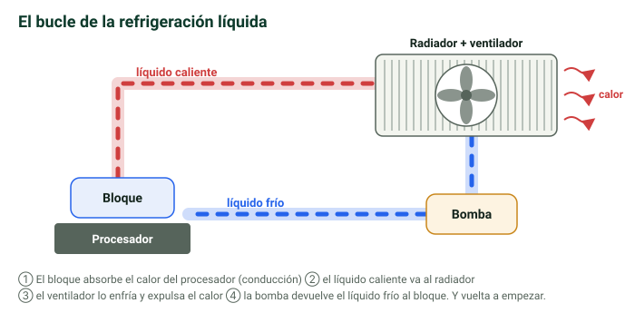
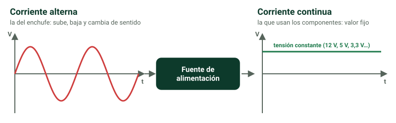

## Caja, torre o chasis {media}

Es la **protección externa** que envuelve los componentes internos. Está hecha sobre todo de **plástico y metal**.

No se elige a la ligera: su **tamaño depende de la placa base** que vaya dentro. Los nombres de las cajas son los mismos que los de los formatos de placa:

- **XL-ATX**: las más grandes.
- **mini-ITX**: las más pequeñas.
- En medio hay otros modelos.

| Caja | Altura | Placas que admite |
|---|---|---|
| **HTPC / Small form** | variable | mini-ITX |
| **Mini torre** | 30–45 cm | micro-ATX, mini-ITX |
| **Media torre** | 45–60 cm | mini-ITX, micro-ATX, ATX |
| **Torre completa** | 55–68 cm | mini-ITX, micro-ATX, ATX, E-ATX |
| **Super/ultra torre** | más de 68 cm | XL-ATX |

> [!truco] Una caja grande admite placas más pequeñas, pero no al revés: en una mini torre **no cabe** una placa ATX.

> [!clave] Primero se elige la **placa base** y después una **caja compatible** con su formato.

```test
¿De qué depende el tamaño de la caja que debes comprar?
+ Del formato de la placa base
- De la potencia de la fuente
- Del número de discos duros
- Del sistema operativo

¿Qué se elige primero al montar un ordenador?
+ La placa base, y después una caja compatible
- La caja, y después una placa que quepa
- La fuente, y después la caja
- Da igual el orden

¿Cabe una placa ATX en una mini torre?
+ No: la mini torre admite micro-ATX y mini-ITX
- Sí, todas las cajas admiten ATX
- Solo si se quita la fuente
- Sí, la mini torre es la caja de las placas ATX
= Para ATX necesitas al menos una media torre.

¿Qué caja es la más grande?
+ Super/ultra torre (XL-ATX)
- Torre completa (E-ATX)
- Media torre (ATX)
- Mini torre (micro-ATX)
```

## Sistemas de refrigeración {alta}

Mantienen la **temperatura** de los componentes en niveles adecuados. Tanto el exceso de calor como el de frío hacen que funcionen mal.

### Refrigeración pasiva {alta}

Ayuda a refrigerar **sin hacer nada activamente**.

- **Disipador**: pieza **metálica** con **láminas en paralelo** que facilitan que circule el aire y que el aire caliente no se acumule sobre el componente.

### Refrigeración activa {alta}

Trabaja **activamente** para controlar la temperatura. Hay dos tipos:

- **Por aire**: con **ventiladores** en el procesador, la fuente de alimentación y la tarjeta gráfica. Se apoya en los disipadores y en las ranuras de ventilación de la caja.
- **Líquida**: un circuito de **tubos con líquido refrigerante**.
  - Es **mejor que la de aire**, porque el líquido **conduce mejor el calor**.
  - Se basa en la **conducción** y la **convección**: el líquido absorbe el calor del **bloque** colocado sobre el procesador y se enfría en un **radiador con ventilador**. Así se forma un **bucle**.
  - Líquidos válidos:
    - **agua destilada** (el agua normal no, porque tiene cal, sal y hasta bacterias);
    - **líquidos biodegradables**;
    - **líquidos con partículas**, que se usan por estética pero pueden dejar sedimentos.



> [!error] Pensar que el ventilador «genera aire frío». **Mueve el aire** para que se renueve y salga el caliente.

| | Pasiva | Activa por aire | Activa líquida |
|---|---|---|---|
| Elemento | Disipador | Ventiladores | Tubos + bloque + radiador |
| ¿Trabaja activamente? | No | Sí | Sí |
| Eficacia | Apoyo | Buena | La mejor: el líquido conduce mejor el calor |

```test
¿Qué tipo de refrigeración es un disipador?
+ Pasiva
- Activa por aire
- Activa líquida
- Mixta

¿Qué hace realmente un ventilador?
+ Mueve el aire para que se renueve y salga el caliente
- Genera aire frío
- Enfría el líquido del circuito
- Absorbe el calor del procesador directamente

¿Por qué la refrigeración líquida es mejor que la de aire?
+ Porque el líquido conduce mejor el calor
- Porque no necesita ventiladores
- Porque es más barata
- Porque el agua del grifo enfría más

¿Qué líquido NO se debe usar en la refrigeración líquida?
+ Agua del grifo
- Agua destilada
- Líquidos biodegradables
- Líquidos con partículas
= El agua del grifo tiene cal, sal e incluso bacterias.

En el circuito de refrigeración líquida, ¿dónde se enfría el líquido?
+ En el radiador con ventilador
- En el bloque que está sobre el procesador
- En la fuente de alimentación
- En el disipador de la gráfica
= En el bloque se calienta (absorbe el calor del procesador).
```

## Fuente de alimentación {alta}

Se conecta a la red eléctrica y **suministra energía a todos los componentes**.

- Su potencia se mide en **vatios (W)**.
- Debe dar **al menos la suma** de lo que consumen todos los componentes. Si da menos, el ordenador puede **no encender** o **apagarse** al subir la carga de trabajo.
- Hay que mirar las especificaciones de cada pieza. Por ejemplo, para una tarjeta gráfica RTX 4090 el fabricante recomienda una fuente de **1000 W**.

> [!clave] La fuente **convierte la corriente alterna** (la de los enchufes) en **corriente continua** (la que usan los componentes por dentro).



La corriente continua digital toma solo dos valores, **0 V y 5 V**: el **0** y el **1** del binario.

> [!nota] Para entenderlo mejor: la fuente entrega varias tensiones continuas **fijas** (12 V, 5 V y 3,3 V). Los «0 V y 5 V» de los apuntes son los dos niveles que usan las **señales digitales** para representar el 0 y el 1: hay tensión (1) o no la hay (0).

```test
¿En qué unidad se mide la potencia de una fuente de alimentación?
+ Vatios (W)
- Voltios (V)
- Hercios (Hz)
- Amperios (A)

¿Qué potencia mínima debe tener la fuente?
+ Al menos la suma de lo que consumen todos los componentes
- Siempre 500 W
- La mitad de lo que consumen los componentes
- La misma que la tarjeta gráfica

¿Qué transformación hace la fuente de alimentación?
+ Convierte corriente alterna en corriente continua
- Convierte corriente continua en alterna
- Sube la tensión del enchufe
- Convierte la corriente en datos binarios

¿Qué pasa si la fuente da menos potencia de la necesaria?
+ El ordenador puede no encender o apagarse al subir la carga
- El ordenador va más lento, pero nunca se apaga
- No pasa nada: la fuente se adapta
- Se estropea el disco duro al instante
```

?? ¿De qué depende el tamaño de la caja que hay que comprar? || Del formato de la placa base que va dentro (de XL-ATX, la más grande, a mini-ITX, la más pequeña).
?? ¿Qué diferencia hay entre refrigeración pasiva y activa? || La pasiva ayuda sin hacer nada activamente (disipadores); la activa trabaja para controlar la temperatura (ventiladores o refrigeración líquida).
?? ¿Cómo funciona un disipador? || Es una pieza metálica con láminas en paralelo que facilitan que circule el aire y que el calor no se acumule. Es refrigeración pasiva.
?? ¿Un ventilador genera aire frío? || No: mueve el aire para renovarlo y que salga el aire caliente.
?? ¿Por qué la refrigeración líquida es mejor que la de aire? || Porque el líquido conduce mejor el calor.
?? ¿Por qué no se usa agua del grifo en la refrigeración líquida? || Porque contiene cal, sal e incluso bacterias. Se usa agua destilada.
?? Explica el circuito de la refrigeración líquida. || El líquido absorbe el calor del bloque sobre el procesador (conducción), se enfría en un radiador con ventilador y vuelve: es un bucle.
?? ¿Qué potencia mínima debe tener la fuente de alimentación? || Al menos la suma de lo que consumen todos los componentes. Se mide en vatios (W).
?? ¿Qué transformación hace la fuente de alimentación? || Convierte la corriente alterna de la red en corriente continua.
?? ¿Qué caja necesitas como mínimo para una placa ATX? || Una media torre (45–60 cm); también vale una torre completa. En una mini torre no cabe.
