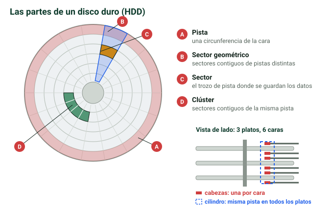
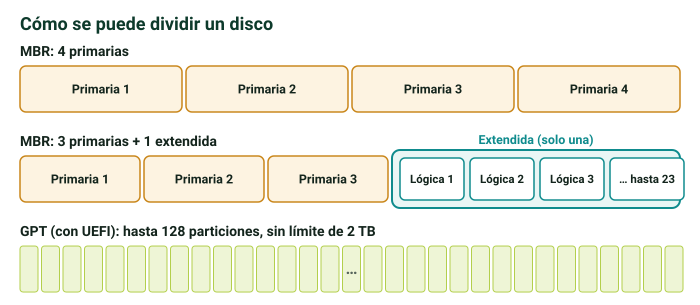

## La jerarquía de memoria {alta}

Los distintos tipos de memoria se relacionan entre sí formando una **pirámide**:

1. **Caché**: arriba. La **más rápida**, la **más pequeña** y la **más cara**.
2. **Memoria principal (RAM)**: en medio.
3. **Almacenamiento secundario**: abajo. El **más lento**, el **más grande** y el **más barato**.

, todavía más rápidos que la caché.")

> [!truco] Cuanto **más arriba** en la pirámide, **más rápido y caro**; cuanto **más abajo**, **más capacidad**. Además, solo el almacenamiento secundario es **permanente**.

```test
Ordena de más rápida a más lenta.
+ Caché → memoria principal (RAM) → almacenamiento secundario
- RAM → caché → almacenamiento secundario
- Almacenamiento secundario → RAM → caché
- Caché → almacenamiento secundario → RAM

¿Qué nivel de la pirámide tiene más capacidad y es más barato?
+ El almacenamiento secundario
- La caché
- La memoria principal
- Todos igual

¿Cuál es el único nivel permanente de la pirámide?
+ El almacenamiento secundario
- La caché
- La memoria RAM
- Ninguno
```

## Memoria RAM {alta}

**RAM** = *Random Access Memory*, memoria de **acceso aleatorio**. Aquí «aleatorio» significa **acceso directo**: se llega a cualquier posición sin recorrer las anteriores (eso sería acceso **secuencial**), así que el tiempo de acceso **siempre es el mismo**.

> [!ejemplo] Acceso directo frente a secuencial es como elegir una canción en un **CD** frente a un **casete**.

- Guarda los **programas en ejecución**, que se llaman **procesos**. El SO crea un proceso por programa y lo aloja en la RAM mientras vive.
- Es **volátil y temporal**: al apagar se borra todo. Por eso pierdes el trabajo o la partida si no guardas.

> [!clave] **Quien ejecuta el proceso es el procesador**, pero para poder ejecutarlo **tiene que estar en la RAM**.

### Tipos de módulo {alta}

| Módulo | Uso | Bus |
|---|---|---|
| **SIMM** | Ordenadores antiguos. Ya no se usa | 16 o 32 bits |
| **DIMM** | **Sobremesa** | 64 bits |
| **SO-DIMM** | **Portátiles**: un DIMM reducido | 64 bits |

```test
¿Qué significa «acceso aleatorio» en la RAM?
+ Acceso directo: se llega a cualquier posición en el mismo tiempo
- Que los datos se guardan en posiciones al azar
- Que hay que recorrer las posiciones anteriores
- Que a veces falla al leer

¿Qué se guarda en la RAM?
+ Los programas en ejecución (procesos)
- Los archivos que guardas para siempre
- La BIOS
- Solo el sistema operativo

¿Quién ejecuta un proceso?
+ El procesador, pero el proceso tiene que estar en la RAM
- La RAM
- El disco duro
- El chipset

¿Qué módulo de RAM llevan los portátiles?
+ SO-DIMM
- DIMM
- SIMM
- GDDR
```

### DDR y GDDR {alta}

- La tecnología actual de los DIMM es **DDR** (*Double Data Rate*), de la familia **SDRAM**.
- Cada versión nueva es **más rápida** y admite **más capacidad por módulo**. Según los apuntes, un **DDR3** tiene como máximo **8 GB** por módulo y un **DDR4**, **16 GB**.
- Con 4 ranuras DDR3, el máximo es **32 GB**; con 4 ranuras DDR4, **64 GB**.
- Hay que mirar **qué tipo de RAM admite la placa**: no basta con querer poner más.
- **GDDR** (*Graphics DDR*): la versión especializada en **gráficos** que usan las tarjetas gráficas (actual: GDDR6/GDDR7).

> [!nota] El PDF dice que la RAM llega «hasta DDR6». En realidad la memoria actual de los ordenadores es **DDR5**; las versiones 6 y 7 que ya se usan son de **GDDR**, en tarjetas gráficas.

### Dual Channel, Quad Channel y Rank {media}

- **Dual Channel**: se accede a **dos módulos a la vez** en lugar de a uno (*Single Channel*), lo que da **más velocidad**.
  - Requiere que el **chipset lo permita**, porque usa otro controlador de memoria.
  - Las ranuras que forman pareja suelen venir del **mismo color**: por ejemplo, la 1 y la 3, y la 2 y la 4.
- **Quad Channel**: más canales todavía, pero rinde **casi igual que Dual Channel**. Solo se nota en programas que usan mucha memoria, como los de renderizado.
- **Single Rank (1Rx…)**: se leen 64 bits a la vez.
- **Dual Rank (2Rx…)**: se leen 64 bits de **cada cara**, es decir, **128 bits a la vez**.
  - El número después de la «x» son los **bits de cada chip**: 1Rx8, 1Rx4, 2Rx8.
  - Cuál conviene más depende del procesador: hay que mirar la recomendación del fabricante.

> [!nota] En el examen, responde como en los apuntes. En realidad, el bus del módulo sigue siendo de **64 bits**: en un Dual Rank los dos rangos no se leen a la vez, sino **alternándose**, y eso da algo más de rendimiento.

> [!error] **Mezclar módulos** de distinta velocidad (MHz), latencia o marca. No se recomienda.

```test
¿Qué significa DDR?
+ Double Data Rate
- Dynamic Data RAM
- Direct Disk Reading
- Dual Data Register

¿Qué es la GDDR?
+ La memoria especializada de las tarjetas gráficas
- La RAM de los portátiles
- Una memoria de solo lectura
- La caché del procesador

¿Qué es el Dual Channel?
+ Acceder a dos módulos de RAM a la vez para ganar velocidad
- Tener RAM en las dos caras del módulo
- Usar dos procesadores
- Duplicar la capacidad de cada módulo

¿Qué ranuras forman pareja en Dual Channel, normalmente?
+ Las del mismo color (por ejemplo, la 1 y la 3)
- Las dos que están juntas (1 y 2)
- Cualquier pareja
- Solo la 1 y la 4

¿Qué no se recomienda al poner varios módulos de RAM?
+ Mezclar módulos de distinta velocidad, latencia o marca
- Usar módulos iguales
- Ponerlos en Dual Channel
- Llenar todas las ranuras
```

## Almacenamiento secundario {alta}

Todos los tipos tienen en común que son **permanentes**: la información **no se borra al apagar**. Es lo que los diferencia de la RAM.

| Tipo | Ejemplos |
|---|---|
| **Magnético** | Disco duro **HDD**, disquetes, cintas magnéticas |
| **Estado sólido (electrónico)** | **SSD**, tarjetas **SD**, **pendrives** USB |
| **Óptico** | **CD, DVD, Blu-ray** |
| Magnetoóptico (obsoleto) | Discos Zip, MiniDisc |

### Disco duro magnético (HDD) {alta}

Es un componente **mecánico**: varias piezas que funcionan gracias a un **motor**.

- **Plato**: cada disco magnetizado.
- **Cara**: cada lado de un plato. Cada plato tiene **dos**.
- **Pista**: cada **circunferencia concéntrica** en la que se divide una cara.
- **Sector**: cada parte en la que se divide una pista. Es donde **se guarda la información**; hoy su tamaño **varía**.
- **Sector geométrico**: sectores contiguos de **pistas diferentes**.
- **Clúster**: sectores contiguos de **la misma pista**.
- **Cilindro**: la **misma pista en todos los platos**. Es un concepto **abstracto**: no existe físicamente.
- **Cabeza de lectura/escritura**: **una por cara**. Se desplaza para leer y escribir.
- **Motor**: hace **girar los platos** y mueve los cabezales.



Se conecta por **IDE** (antiguo) o **SATA**.

> [!clave] **Un archivo ocupa en disco como mínimo un sector**, aunque pese menos. Por eso **no es lo mismo el tamaño del fichero que lo que ocupa en disco**.

> [!ejemplo] Compruébalo en Windows: clic derecho en un archivo → **Propiedades**, y compara «Tamaño» con «Tamaño en disco». En la práctica, NTFS reserva el espacio en **clústeres de 4 KB**, así que un archivo de 5 KB ocupa **8 KB** en disco.

```test
¿Qué tienen en común todos los tipos de almacenamiento secundario?
+ Son permanentes: no se borran al apagar
- Son mecánicos
- Usan láser
- Son más rápidos que la RAM

¿Qué es un cilindro en un disco duro?
+ La misma pista en todos los platos
- Cada lado de un plato
- El motor que hace girar los platos
- Un grupo de sectores de la misma pista

¿Qué diferencia hay entre un sector geométrico y un clúster?
+ El geométrico son sectores contiguos de pistas distintas; el clúster, de la misma pista
- Son lo mismo
- El clúster cruza varias pistas; el geométrico no
- El geométrico es físico y el clúster no existe

¿Cuántas cabezas de lectura/escritura tiene un disco duro?
+ Una por cara
- Una por plato
- Una para todo el disco
- Una por pista

Un archivo de 1 byte, ¿cuánto ocupa en el disco?
+ Como mínimo un sector entero
- 1 byte exacto
- Nada
- Un plato entero
```

### Estado sólido: SSD, SD y USB {alta}

- El **SSD** (*Solid State Disk*) **no tiene partes mecánicas**: son **chips de memoria soldados a una PCB**.
- Accede, lee y escribe **mucho más rápido** que un HDD.
- Se conecta por **SATA** o **M.2**.
- También son de estado sólido las **tarjetas SD** y los **pendrives**.

### Ópticos: CD, DVD y Blu-ray {alta}

Leen y escriben con una **lente y luz láser**. La diferencia está en el **color del láser**:

- **Cuanto menor es la longitud de onda**, **más finas son las pistas** y **más capacidad** tiene el disco.
- El **CD** es el de mayor longitud de onda; el **Blu-ray** (rayo **azul**), el de menor.

| Disco | Láser | Capacidad |
|---|---|---|
| **CD** | infrarrojo (mayor longitud de onda) | **700 MB** |
| **DVD** | **rojo** | **4,7 GB** |
| **Blu-ray** | **azul** | hasta **50 GB** |

Como curiosidad, el **HD DVD** de Toshiba fue el rival del Blu-ray y desapareció. El **Blu-ray Ultra HD** reproduce 4K y llega a **100 GB** en triple capa.

```test
¿Por qué un SSD es mucho más rápido que un HDD?
+ Porque no tiene partes mecánicas: son chips de memoria
- Porque gira más deprisa
- Porque usa láser
- Porque tiene más platos

¿Por dónde se conecta un SSD?
+ Por SATA o por M.2
- Solo por IDE
- Por PCI
- Por VGA

¿Por qué un Blu-ray tiene más capacidad que un DVD?
+ Su láser azul tiene menor longitud de onda: pistas más finas
- Su láser rojo tiene mayor longitud de onda
- Porque gira más rápido
- Porque tiene dos caras

¿Cuánto cabe en un DVD?
+ 4,7 GB
- 700 MB
- 50 GB
- 100 GB
```

## Particiones {alta}

Una **partición** es una **división lógica** del disco, hecha **por software**, no físicamente.

### MBR y GPT {alta}

| | **MBR** (*Master Boot Record*) | **GPT** (*GUID Partition Table*) |
|---|---|---|
| Firmware | BIOS antigua | **UEFI** |
| Nº de particiones | 4 primarias, o 3 primarias + 1 extendida | Hasta **128** (en Windows) |
| Tamaño máximo por partición | **2 TB** | No es un problema |
| Uso | Cada vez menos | El actual |

- **GUID** = *Global Unique IDentifier*: un **identificador único** para cada partición.
- GPT **no es compatible** con MBR, pero guarda un **MBR de protección** al principio. Las herramientas antiguas ven así una sola partición que ocupa todo el disco; UEFI lo ignora.

### Tipos de partición en MBR {alta}

- **Primaria**: como **máximo 4**, de hasta **2 TB** cada una. Es donde se **instala un sistema operativo**. En la BIOS, el **Boot Sequence** elige de cuál arranca.
- **Extendida (secundaria)**: **solo una**, y ocupa el lugar de una primaria. Puede contener hasta **23 particiones lógicas**.
- **Lógica**: va **dentro de la extendida** y sirve para **guardar archivos**. Al crearla se elige su sistema de archivos.

> [!clave] Combinaciones válidas en MBR: **4 primarias**, o **3 primarias + 1 extendida** (con sus lógicas dentro).



### Sistemas de archivos y formateo {alta}

- **NTFS**: el predominante en **Windows**.
- **FAT32**: Windows. No admite **ficheros de más de 4 GB**, por eso está en desuso.
- **Ext4**: **Linux**.

**Formatear** es dar a una **partición** (no al disco entero) un sistema de archivos. **Borra todo lo que tenía**.

```test
¿Qué es una partición?
+ Una división lógica del disco, hecha por software
- Una división física del disco
- Un tipo de disco duro
- Un sistema de archivos

¿Qué combinaciones de particiones admite MBR?
+ 4 primarias, o 3 primarias + 1 extendida
- Hasta 128 primarias
- 2 primarias y 2 extendidas
- 1 primaria y hasta 23 extendidas

¿Cuántas particiones lógicas caben en una extendida?
+ Hasta 23
- Hasta 4
- Hasta 128
- Solo 1

¿Qué tabla de particiones va con UEFI y admite hasta 128 particiones?
+ GPT
- MBR
- FAT32
- NTFS

¿Dónde se instala un sistema operativo en un disco MBR?
+ En una partición primaria
- En una partición lógica
- En la partición extendida
- En el MBR

¿Qué limitación tiene FAT32?
+ No admite ficheros de más de 4 GB
- No funciona en Windows
- Solo admite 4 particiones
- No se puede formatear

¿Qué pasa al formatear una partición?
+ Se le da un sistema de archivos y se borra todo lo que tenía
- Se divide en dos
- Se desfragmenta sin perder nada
- Se convierte en extendida
```

?? Ordena la jerarquía de memoria de más rápida a más lenta. || Caché → memoria principal (RAM) → almacenamiento secundario.
?? ¿Qué significa «acceso aleatorio» en la RAM? || Acceso directo: se llega a cualquier posición sin recorrer las anteriores, siempre en el mismo tiempo.
?? ¿Quién ejecuta un proceso y dónde tiene que estar? || Lo ejecuta el procesador, pero el proceso tiene que estar cargado en la RAM.
?? ¿Qué diferencia hay entre DIMM y SO-DIMM? || DIMM es para ordenadores de sobremesa y SO-DIMM es su formato reducido para portátiles.
?? ¿Qué significan DDR y GDDR? || DDR = Double Data Rate (RAM del ordenador); GDDR = Graphics DDR (memoria de las tarjetas gráficas).
?? ¿Qué es el Dual Channel y qué necesita? || Acceder a dos módulos de RAM a la vez para ganar velocidad; el chipset tiene que permitirlo.
?? ¿Qué diferencia hay entre Single Rank y Dual Rank? || Single Rank lee 64 bits a la vez; Dual Rank lee 64 bits de cada cara (128 bits a la vez).
?? ¿Qué tienen en común todos los tipos de almacenamiento secundario? || Son permanentes: no se borran al apagar.
?? ¿Qué es una pista, un sector y un cilindro en un HDD? || Pista: circunferencia concéntrica de una cara. Sector: cada parte de una pista donde se guarda la información. Cilindro: la misma pista en todos los platos (concepto abstracto).
?? ¿Por qué un archivo ocupa en disco más de lo que pesa? || Porque se guarda en sectores y como mínimo ocupa un sector completo.
?? ¿Por qué un SSD es más rápido que un HDD? || Porque no tiene partes mecánicas: son chips de memoria en una PCB.
?? ¿Por qué un Blu-ray tiene más capacidad que un DVD? || Su láser azul tiene menor longitud de onda, así que las pistas son más finas y cabe más información.
?? Capacidad de CD, DVD y Blu-ray. || CD 700 MB, DVD 4,7 GB y Blu-ray hasta 50 GB.
?? ¿Qué es una partición? || Una división lógica del disco, hecha por software.
?? Limitaciones de MBR frente a GPT. || MBR: máximo 4 primarias (o 3 + 1 extendida) de hasta 2 TB cada una. GPT: hasta 128 particiones y no tiene ese límite de tamaño.
?? ¿Cuántas particiones lógicas puede contener una extendida? || Hasta 23.
?? ¿Qué limitación tiene FAT32? || No admite ficheros de más de 4 GB.
?? ¿Qué sistema de archivos se usa en Windows y cuál en Linux? || Windows: NTFS. Linux: Ext4.
?? ¿Qué es formatear? || Dar a una partición un sistema de archivos; borra todo su contenido.
?? En un HDD, ¿qué diferencia hay entre sector geométrico y clúster? || El sector geométrico son sectores contiguos de pistas distintas; el clúster, sectores contiguos de la misma pista.
