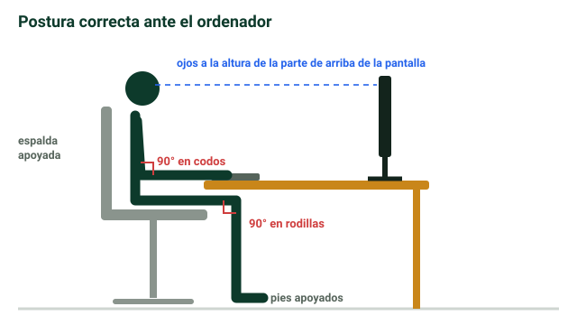

## Seguridad con los equipos e instalaciones {alta}

- **Cables**: nunca tirados por el suelo; siempre **lo más estirados posible**.
  - Así se evita la **diafonía**: interferencias por los **campos electromagnéticos** de cables cercanos.
  - Enmarañados forman **nudos** (pequeñas protuberancias) y **pierden sus condiciones**.
  - Mal recogidos, además, te puedes **caer**.
- Las **revisiones** las hace **solo personal cualificado**.

> [!truco] La diafonía es como oír la conversación de la mesa de al lado: la señal de un cable **se cuela** en el cable vecino.
- **Repartir la carga**: las **regletas** tienen una potencia máxima; si se supera puede haber hasta un **incendio**.
- **No dejar los ordenadores siempre encendidos**: necesitan mucha más refrigeración.
- **No pegarlos a la pared**: hay que dejar espacio para que se refrigeren.

> [!clave] En un **cortocircuito** se usan **extintores de CO₂**: eliminan el **oxígeno** sin **dañar los componentes**. Un extintor normal sería **contraproducente**.

## Ergonomía y entorno de trabajo {alta}

- **Luz natural** mejor que artificial.
- Trabajar cerca de una **ventana** para **oxigenar** el aire: se respira mejor y **aumenta la concentración**.
- Paredes y techos en **tonos suaves**, que ayudan a concentrarse.
- **Evitar los ruidos**.
- **Postura**: **90°** en brazos y piernas.
- **Teclado y silla** a la altura correcta.
- **Ratón cómodo**, para evitar el **síndrome del túnel carpiano**.
- **Evitar los monitores CRT** (tubo de rayos catódicos: los antiguos, con mucho fondo, que emitían mucha luz). Mejor **LED**.

## Riesgos para la salud {alta}

| Riesgo | Qué es |
|---|---|
| **Trastornos musculoesqueléticos** | Problemas musculares u óseos por **esfuerzos o malas posturas**. Típico: la espalda |
| **Trastornos visuales** | Por un uso **incorrecto o abusivo de pantallas** |
| **Fatiga mental** | Cansancio por **estrés prolongado**, ansiedad, depresión, exceso de tareas o falta de recursos |
| **Factor psicosocial: burnout** | Síndrome de «**estar quemado**»: saturación de trabajo o un trabajo que no gusta |

> [!error] Confundir **fatiga mental** con **somnolencia**. La somnolencia es solo **necesidad de dormir**; la fatiga mental viene del estrés y la sobrecarga.

?? ¿Por qué hay que tener los cables estirados y no enmarañados? || Para evitar la diafonía (interferencias electromagnéticas), que se formen nudos y pierdan sus condiciones, y para no tropezar.
?? ¿Qué es la diafonía? || Las interferencias causadas por los campos electromagnéticos de cables que están próximos.
?? ¿Qué extintor se usa en un cortocircuito y por qué? || Uno de CO₂: elimina el oxígeno sin dañar los componentes.
?? ¿Por qué no se deben sobrecargar las regletas? || Porque tienen una potencia máxima; si se supera se puede producir hasta un incendio.
?? ¿Por qué no hay que pegar el ordenador a la pared ni dejarlo siempre encendido? || Para que se refrigere bien: necesita espacio, y si está siempre encendido necesita mucha más refrigeración.
?? ¿Cuál es la postura ideal al sentarse? || 90° en brazos y piernas, con teclado y silla a la altura correcta.
?? ¿Qué es el burnout? || Un factor psicosocial: el síndrome de «estar quemado» por saturación de trabajo o por un trabajo que no gusta.
?? ¿Qué diferencia hay entre fatiga mental y somnolencia? || La fatiga mental viene del estrés, la ansiedad o la sobrecarga de tareas; la somnolencia es solo necesidad de dormir.
?? ¿Qué problema se previene usando un ratón cómodo? || El síndrome del túnel carpiano.
?? ¿Qué tipo de monitor hay que evitar y cuál es preferible? || Evitar los CRT (tubo de rayos catódicos); mejor pantallas LED.
