## Qué es el software {media}

El **software** es la **parte lógica**: todos los programas. **Complementa al hardware**: ninguno tiene sentido sin el otro.

> [!clave] **No existe ningún programa 100 % libre de errores** (salvo los triviales, como un «Hola, mundo»). Que tenga errores no significa que sea inseguro: refleja lo complejo que es el software.

**Las pruebas en software funcionan al revés que en otras ingenierías**:

- **Puente**: la prueba es **satisfactoria si no se cae**, es decir, si no hay errores.
- **Software**: la prueba es **satisfactoria si encuentra algún error**, porque siempre los hay. Si no encuentra ninguno, es que **no se ha buscado bien**.

El software es **intangible**: el cliente no ve el trabajo que hay detrás. Para él, un «simple botón» puede ocultar un desarrollo enorme.

```test
¿Existe algún programa complejo 100 % libre de errores?
+ No: todo programa complejo tiene algún error
- Sí, si se prueba lo suficiente
- Sí, los de código abierto
- Solo los sistemas operativos

¿Cuándo es satisfactoria una prueba de software?
+ Cuando encuentra algún error
- Cuando no encuentra ningún error
- Cuando el programa no se cuelga
- Cuando el cliente está contento
= Si no encuentra ninguno, es que no se ha buscado bien. En un puente es al revés.

¿Por qué se dice que el software es intangible?
+ Porque el cliente no ve el trabajo que hay detrás
- Porque no ocupa espacio en disco
- Porque es gratis
- Porque no tiene errores
```

## Licencias de software {alta}

| Licencia | Características |
|---|---|
| **Privativo** | Hay que **pagar la licencia**. No se puede copiar ni distribuir sin permiso del autor. Ejemplos: **Windows**, videojuegos. Licencia típica: **copyright** |
| **Libre** | **Distribución libre**: se puede descargar y distribuir. Ejemplo: **LibreOffice**. Licencia típica: **copyleft** |
| **Código abierto (open source)** | Además de libre, **se puede modificar**, pero **no lucrarse** con él después |
| **Freeware** | **Gratuito**, pero **sin código fuente** |
| **Shareware** | **Uso completo por tiempo limitado**, o **uso ilimitado con funciones limitadas** |

> [!error] Pensar que **libre** significa **gratuito**. Casi todo el software libre es gratis, pero **no tiene por qué**. La confusión viene del inglés *free software*, donde *free* quiere decir **libre**, no gratis. **Freeware** sí significa gratuito.

> [!nota] La tabla sigue la definición de los apuntes, que es la que debes dar en el examen. Fuera de clase, la definición oficial de software libre (FSF) **incluye** el acceso al código fuente y la libertad de modificarlo, e incluso de venderlo.

```test
¿Qué es el freeware?
+ Software gratuito sin código fuente
- Software libre con código fuente
- Software de pago
- Software de prueba por tiempo limitado

¿Qué es el shareware?
+ Uso completo durante un tiempo, o ilimitado con funciones limitadas
- Software gratuito sin código fuente
- Software que se puede modificar libremente
- Software solo para empresas

¿El software libre tiene que ser gratis?
+ No: free significa libre, no gratis
- Sí, siempre
- Solo si es de código abierto
- Sí, por ley

¿Qué licencia es típica del software privativo?
+ El copyright
- El copyleft
- El shareware
- El freeware
= La del software libre es el copyleft.
```

## Sistemas operativos {alta}

El SO hace que el ordenador **deje de ser un pisapapeles**. **Controla y gestiona todos los recursos**:

- **Memoria**: qué procesos entran y en qué posición.
- **Planificación de la CPU**: qué procesos la usan, en qué orden y durante cuánto tiempo.
- **Ficheros, red, seguridad y usuarios**.

Debe estar **optimizado**, porque de él depende el rendimiento de todo el sistema. La 3.ª evaluación trata solo de sistemas operativos.

### Clasificación de los SO {alta}

| Criterio | Tipos |
|---|---|
| **Nº de usuarios** | **Monousuario** (MS-DOS, ya no se usa) · **Multiusuario** (Windows, Linux, macOS, Android, iOS) |
| **Nº de tareas** | **Monotarea**: una tarea a la vez (MS-DOS) · **Multitarea**: varias a la vez (Windows) |
| **Estructura** | **Cliente**: de propósito general, el de tu ordenador · **Servidor**: por ejemplo Windows Server; centraliza la administración, como crear los usuarios una vez en el servidor y usarlos desde cualquier equipo |

```test
¿Qué gestiona el sistema operativo?
+ Memoria, CPU, ficheros, red, seguridad y usuarios
- Solo los ficheros
- Solo la conexión a internet
- Solo los periféricos

MS-DOS era un sistema…
+ monousuario y monotarea
- multiusuario y multitarea
- monousuario y multitarea
- servidor

¿Qué ventaja tiene un SO servidor como Windows Server?
+ Centraliza la administración: los usuarios se crean una vez y sirven en cualquier equipo
- Es más barato que un SO cliente
- No necesita hardware
- Funciona sin red
```

## Software de programación {alta}

- **IDE** (entorno integrado de desarrollo): reúne en **un solo programa** todo lo necesario para programar: editor, compilador o intérprete, plugins… Por ejemplo, **Eclipse** o **IntelliJ**.
- **Compilador**: a partir del código fuente **comprueba que no haya errores léxicos ni sintácticos**, **optimiza** el código y **genera un ejecutable**. Por ejemplo, **Java**.
- **Intérprete**: **no compila antes**; lee y ejecuta el código **línea a línea en tiempo de ejecución**. Por ejemplo, **Python**.
- **Lenguajes de programación**: Java, Python, JavaScript, PHP, Go, Dart, Rust, Swift, Kotlin…

> [!truco] **Compilado** = traduce todo antes y crea un ejecutable. **Interpretado** = traduce línea a línea mientras se ejecuta.



## Gestores de bases de datos {alta}

- **Ofimáticos**: bases de datos **a pequeña escala**, no profesionales. Por ejemplo, **Access**.
- **Profesionales**: para empresas.
  - **Relacionales**: usan el modelo relacional y el lenguaje **SQL**. **MySQL, PostgreSQL, Oracle, SQL Server**.
  - **NoSQL**: **no usan SQL**, sino otros modelos. **MongoDB** (muy usado) y **Cassandra** (la usaba Twitter).

```test
Un programa tiene un error en la línea 3. ¿Qué hace un intérprete?
+ Ejecuta las líneas 1 y 2 y se para al llegar a la 3
- No ejecuta nada
- Corrige el error solo
- Ejecuta todo menos la línea 3

¿Qué hace un compilador?
+ Comprueba errores léxicos y sintácticos, optimiza y genera un ejecutable
- Ejecuta el código línea a línea
- Diseña la interfaz del programa
- Gestiona la base de datos

Java es un lenguaje… y Python es…
+ compilado; interpretado
- interpretado; compilado
- compilado; compilado
- interpretado; interpretado

¿Qué es un IDE?
+ Un programa que reúne editor, compilador o intérprete y plugins
- Un tipo de conector de discos
- Un lenguaje de programación
- Un sistema operativo

¿Qué gestor de bases de datos es NoSQL?
+ MongoDB
- MySQL
- PostgreSQL
- Oracle
```

## Aplicaciones ofimáticas {media}

«Ofimática» viene de **oficina**; con los PC llegó también a casa.

- **Procesador de texto**: documentos con **formato, imágenes y tablas**. Word, Writer.
- **Hoja de cálculo**: información en **tablas** para operar y analizar. Excel, Calc.
- **Presentaciones**: diapositivas. PowerPoint, Impress, Prezi.

> [!error] Confundir **procesador** de texto con **editor** de texto. El **editor** solo crea **texto plano**, sin formato: Bloc de notas, VS Code, Notepad++, Atom, Brackets.

```test
¿Qué diferencia hay entre un procesador de texto y un editor de texto?
+ El procesador admite formato, imágenes y tablas; el editor solo texto plano
- Son lo mismo
- El editor admite formato y el procesador no
- El procesador es gratuito y el editor no

¿Cuál de estos es un editor de texto (no un procesador)?
+ VS Code
- Word
- Writer
- Google Docs
```

## Malware y antimalware {alta}

**Malware** = *malicious software*: cualquier software que busca **dañar** el sistema. Llamarlo todo «virus» es **incorrecto**: el virus es **un tipo** de malware.

| Tipo | Qué hace |
|---|---|
| **Virus** | Ataca los **archivos** para **destruirlos**: su objetivo es hacer daño |
| **Gusano (worm)** | **Se autorreplica** hasta **llenar la memoria** y bloquear el sistema, o al menos ralentizarlo. No busca destruir archivos |
| **Troyano** | Parece que **no hace nada** hasta que salta un **evento** (por ejemplo, una fecha). Entonces puede hacer casi cualquier cosa, incluso **formatear el disco** |
| **Keylogger** | Registra las **teclas pulsadas** para robar datos y **contraseñas** |
| **Spyware** | **Espía**: no ataca, **recopila datos y los envía** |
| **Ransomware** | **Cifra** la información y **pide un rescate** por la clave. Aunque pagues, suele instalar otro malware, como un troyano |

Protección: **antivirus y antimalware**, como **Malwarebytes**.

> [!truco] **Virus** destruye · **gusano** se copia · **troyano** se esconde y espera · **keylogger** apunta tus teclas · **spyware** espía · **ransomware** secuestra.

```test
¿Es correcto llamar «virus» a todo el malware?
+ No: el virus es solo un tipo de malware
- Sí, son sinónimos
- Solo si ataca archivos
- Sí, desde el año 2000

¿Qué hace un gusano?
+ Se autorreplica hasta llenar la memoria y bloquear o ralentizar el sistema
- Destruye los archivos
- Cifra tus datos y pide un rescate
- Registra las teclas que pulsas

¿Qué malware cifra tus datos y pide un rescate?
+ Ransomware
- Troyano
- Spyware
- Keylogger

¿Cómo actúa un troyano?
+ Parece que no hace nada hasta que salta un evento, como una fecha
- Se copia sin parar desde el primer momento
- Solo espía y envía datos
- Muestra publicidad

¿Qué diferencia hay entre un keylogger y un spyware?
+ El keylogger registra las teclas; el spyware recopila todo lo que puede y lo envía
- Son lo mismo
- El spyware registra las teclas; el keylogger cifra los datos
- El keylogger destruye archivos
```

## Otro software {media}

### Software colaborativo {media}

- **Comunicación electrónica**:
  - **correo electrónico**: el más usado;
  - **grupos de noticias**: con o sin moderador;
  - **foros**: debate; los mensajes **no van en orden cronológico**;
  - **blogs**: entradas en **orden cronológico descendente**; viene de *web log*, «bitácora»;
  - **wikis**: varios usuarios aportan información voluntariamente, como la Wikipedia.
- **Conferencia**:
  - **teleconferencia**: solo voz;
  - **videoconferencia**: voz y vídeo;
  - **chat**: texto;
  - **mensajería instantánea**: mensajes multimedia en tiempo real (WhatsApp, Signal).

### Acceso remoto {alta}

- **TeamViewer**: controla otro equipo y **los dos ven lo que ocurre**.
- **Escritorio remoto de Windows**: se conecta con **IP, usuario y contraseña**; la sesión del equipo de origen **queda interrumpida** mientras dura la conexión.
- Protocolos **Telnet** y **SSH**: **SSH cifra** la información y **Telnet no**, así que Telnet es menos seguro. **PuTTY** permite usar los dos.

> [!ejemplo] Si te conectas por **Telnet** desde una wifi pública, quien capture el tráfico verá tu usuario y tu contraseña **tal cual**. Con **SSH** solo vería datos cifrados.

### Comercio electrónico y redes sociales {baja}

- **E-commerce**: comprar y vender por Internet (Amazon, eBay).
- **E-business**: todo lo del e-commerce **más el resto de procesos de la empresa**: almacén, producción, finanzas…
- **Redes sociales**: aplicaciones con componente social (Instagram, TikTok, X…). Su gran problema es el **anonimato** que facilita el mal uso. Bluesky apuesta por la descentralización y la portabilidad de los datos.

```test
¿En qué se diferencian un foro y un blog?
+ En el blog las entradas van en orden cronológico descendente; en el foro no
- En el foro hay orden cronológico; en el blog no
- El blog es privado y el foro público
- No hay diferencia

¿Qué diferencia hay entre Telnet y SSH?
+ SSH cifra la información; Telnet no
- Telnet cifra la información; SSH no
- SSH es para Windows y Telnet para Linux
- Telnet es más moderno

Con el escritorio remoto de Windows…
+ la sesión del equipo de origen se interrumpe
- los dos usuarios ven lo mismo a la vez
- no hace falta IP ni contraseña
- solo se pueden copiar archivos
= Con TeamViewer, en cambio, los dos ven lo que ocurre.

¿Qué es el e-business?
+ El comercio electrónico más el resto de procesos de la empresa
- Comprar y vender por internet, sin más
- Las redes sociales de empresa
- Un tipo de malware

¿Qué herramienta permite mensajes multimedia en tiempo real?
+ La mensajería instantánea (WhatsApp, Signal)
- La teleconferencia
- El grupo de noticias
- El blog
```

?? ¿Existe algún programa (no trivial) 100 % libre de errores? || No. Todo programa complejo tiene algún error, aunque no sea crítico.
?? ¿Cuándo es satisfactoria una prueba de software? || Cuando encuentra algún error; si no encuentra ninguno, es que no se ha buscado bien.
?? ¿El software libre tiene que ser gratuito? || No. Free software significa libre, no gratis; el que sí es gratuito es el freeware.
?? Diferencia entre freeware y shareware. || Freeware: gratuito sin código fuente. Shareware: uso completo durante un tiempo limitado, o ilimitado con funciones limitadas.
?? ¿Qué licencia es típica del software privativo y cuál del libre? || Privativo: copyright. Libre: copyleft.
?? ¿Qué recursos gestiona el sistema operativo? || Memoria, planificación de la CPU, ficheros, red, seguridad y usuarios.
?? Clasifica los SO según usuarios, tareas y estructura. || Monousuario/multiusuario; monotarea/multitarea; cliente/servidor.
?? ¿Qué ventaja tiene un SO servidor como Windows Server? || Centraliza la administración: por ejemplo, los usuarios se crean una vez en el servidor y se usan desde cualquier equipo.
?? Diferencia entre compilador e intérprete. || El compilador revisa errores léxicos y sintácticos, optimiza y genera un ejecutable antes (Java); el intérprete ejecuta línea a línea en tiempo de ejecución (Python).
?? ¿Qué es un IDE? Pon dos ejemplos. || Un entorno integrado de desarrollo que reúne editor, compilador o intérprete y plugins. Eclipse e IntelliJ.
?? Diferencia entre gestores de BD relacionales y NoSQL, con ejemplos. || Relacionales: usan SQL (MySQL, PostgreSQL, Oracle). NoSQL: otros modelos (MongoDB, Cassandra).
?? Diferencia entre procesador y editor de texto. || El procesador admite formato, imágenes y tablas (Word); el editor solo texto plano (Bloc de notas, VS Code).
?? ¿Es correcto llamar «virus» a todo el malware? || No: el virus es solo un tipo de malware (también hay gusanos, troyanos, keyloggers, spyware y ransomware).
?? ¿Qué hace un gusano? || Se autorreplica hasta llenar la memoria y bloquear o ralentizar el sistema.
?? ¿Cómo funciona un troyano? || Permanece oculto sin hacer nada hasta que salta un evento (por ejemplo una fecha); entonces puede hacer casi cualquier cosa.
?? ¿Qué es el ransomware? || Malware que cifra tus datos y pide un rescate por la clave; aunque pagues, suele instalar otro malware.
?? Diferencia entre keylogger y spyware. || El keylogger registra las teclas pulsadas para robar contraseñas; el spyware recopila todos los datos que puede y los envía.
?? Diferencia entre Telnet y SSH. || SSH cifra la información; Telnet no, así que es menos seguro.
?? Diferencia entre escritorio remoto de Windows y TeamViewer. || Con el escritorio remoto la sesión del equipo de origen se interrumpe; con TeamViewer los dos ven lo que ocurre.
?? Diferencia entre foro y blog. || En el blog las entradas van en orden cronológico descendente; en el foro los mensajes no siguen un orden cronológico.
?? Diferencia entre e-commerce y e-business. || E-commerce es comprar y vender por Internet; e-business añade el resto de procesos de la empresa (almacén, producción, finanzas).
?? Si un programa tiene un error en la línea 3, ¿qué pasa con un compilador y qué con un intérprete? || El compilador detecta el error antes y no ejecuta nada; el intérprete ejecuta las líneas 1 y 2 y se para al llegar a la 3.
