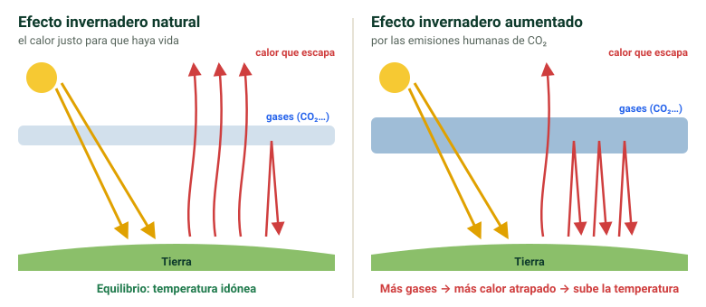
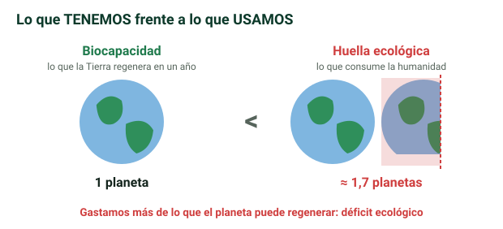

## La emergencia ambiental {alta}

La **emergencia ambiental** es un escenario en el que existe un **peligro grave y cierto** que pone en riesgo a **prácticamente todas las especies animales y vegetales**.

> [!clave] **¿Somos iguales frente a la emergencia climática?** **No.** Afecta más a las naciones con **menos recursos económicos**, **menor nivel educativo** o **condiciones ambientales frágiles**.

### Escalas del impacto {alta}

| Escala | Alcance | Ejemplos |
|---|---|---|
| **Local** | El territorio inmediato | Destrucción de un bosque, lluvias torrenciales |
| **Regional** | Grandes territorios | Los mismos fenómenos, pero sobre una zona amplia |
| **Global** | Todo el planeta | Contaminación, quema de combustibles fósiles |

### Lugares que ya lo sufren {media}

Las diapositivas 4 a 12 son solo fotos. Muestran lugares donde ya se notan los efectos:

- **Islas bajas de Oceanía**, que pueden desaparecer por la **subida del nivel del mar**. En la cumbre del clima COP26 (2021), el ministro de Exteriores de **Tuvalu** dio su discurso con el agua por las rodillas para denunciarlo.
- **Ciudades costeras** que se inundan o se hunden, como **Yakarta** (Indonesia) o **Venecia**, y temporales que golpean el litoral.
- **Zonas secas** que avanzan hacia la desertificación y ciudades de países con pocos recursos, los más vulnerables.

## Las 7 principales amenazas {alta}

| Amenaza | Explicación |
|---|---|
| **Cambio climático** | Aumento del **efecto invernadero** por las actividades industriales y la **quema de combustibles fósiles** |
| **Deforestación** | Menos bosque = **menos capacidad de absorber CO₂ y producir O₂**. Pone en peligro la biodiversidad |
| **Agotamiento del suelo** | Causado por la **agricultura intensiva**, que agota los nutrientes |
| **Pérdida de biodiversidad** | La **acción antrópica** (humana) extingue especies y altera los procesos de los ecosistemas |
| **Cambio oceánico** | El océano **absorbe CO₂ y se acidifica**, lo que daña a las especies marinas; el calor provoca **tifones y huracanes** |
| **Contaminación** | Altera el **aire, la tierra y el agua** y causa graves problemas de salud a todas las especies |
| **Generación de plásticos** | Muy contaminantes, tardan **miles de años en degradarse** y los animales los ingieren, así que entran en **toda la cadena alimentaria** |

> [!truco] Las 7 amenazas: **C**lima, **D**eforestación, **S**uelo, **B**iodiversidad, **O**céano, **C**ontaminación, **P**lásticos.

### El cambio oceánico: la acidificación {media}

Según la infografía de las diapositivas:

- Alrededor del **30 % del CO₂** que emitimos **acaba en el mar** y lo vuelve **cada vez más ácido**.
- Eso **complica el desarrollo** de **moluscos, corales y crustáceos**, que necesitan un agua menos ácida para formar sus **conchas y esqueletos**.
- También **confunde a los peces**: altera su **olfato**.
- Sumado a los **plásticos** y al **aumento de temperatura**, pone en peligro los océanos tal y como los conocemos.

### El efecto invernadero {alta}

- Es un **fenómeno natural** y **principalmente positivo**: mantiene el planeta a una **temperatura idónea para la vida**.
- En las últimas décadas se ha **desequilibrado por la acción humana**, que aumenta la emisión de **gases de efecto invernadero**, sobre todo **CO₂**.

> [!error] Decir que el efecto invernadero es malo en sí mismo. Es **natural y necesario**; el problema es su **aumento** por la actividad humana.

## La naturaleza agotada {alta}

- **Biodiversidad**: la **variedad de especies** que viven en un ecosistema determinado.
- **Ecosistema**: el conjunto de **especies de un área** que **interactúan entre sí y con su ambiente abiótico** (lo no vivo).
  - Sus beneficios: **regulan el clima**, dan **alimentos**, **purifican el agua y el aire** y producen **materia orgánica** que fertiliza la tierra.

### Tipos de ecosistemas {media}

| Tipo | Ejemplos |
|---|---|
| **Acuáticos** | Ríos y lagos, marinos |
| **Terrestres** | Desiertos, montañas, bosques |
| **Mixtos** (agua y tierra) | Manglares, bosques de ribera, costas |
| **Artificiales** | Creados por el ser humano: ciudades, cultivos, jardines… |

### ¿Por qué se está reduciendo la biodiversidad? {alta}

| Causa | Qué es |
|---|---|
| **Directa** | **Favorecer** a un grupo de especies valiosas para nosotros y **eliminar las demás** |
| **Indirecta** | Consecuencia de la **deforestación**, la **contaminación**, el **cambio climático**… |

### Biocapacidad planetaria {alta}

Índice que mide la **capacidad del planeta para producir recursos** naturales y **procesar los residuos**. Indica **cuántos recursos nos ofrece la Tierra cada año**.

- **No toda la superficie es biológicamente productiva**.
- Sin **consumo responsable** hay **riesgo de agotamiento**.

## La huella ecológica {alta}

Mide el **impacto de las actividades humanas** en la naturaleza. Se calcula como la **superficie terrestre necesaria** para **producir los recursos** de una actividad y **procesar sus residuos**.

> [!clave] **Huella ecológica = cuántos recursos USAMOS**. **Biocapacidad = cuántos recursos TENEMOS**.

> [!extra] Según la Global Footprint Network, la humanidad consume cada año lo que la Tierra tardaría unos **1,7 años** en regenerar: es como vivir en **1,7 planetas**. Cuando la huella supera a la biocapacidad se habla de **déficit ecológico**.

### Tipos de huella {alta}

| Huella | Qué demanda |
|---|---|
| **Forestal** | **Bosques**: madera de la tala y deforestación para ganar tierra de cultivo |
| **Pastoreo** | **Pastizales**: pastos y cereales para alimentar al ganado |
| **Pesca** | **Ecosistemas acuáticos**. La **sobrepesca** pone en riesgo especies de alto valor comercial |
| **Cultivo** | **Tierras** para producir **alimentos y combustibles vegetales** |
| **Suelo urbanizado** | Superficie productiva **ocupada por ciudades**, a menudo en zonas de alto valor productivo |
| **Carbono** | **Emisiones de CO₂** a la atmósfera |

> [!clave] La **huella de carbono** es la **única que no mide una demanda de recursos**, sino una **producción**: la de CO₂.

Para calcular tu huella **hídrica** y de **carbono** existen calculadoras como las de la Fundación Aquae.

### ¿Podemos reducir nuestra huella ecológica? {alta}

Sí. Las diapositivas proponen siete medidas:

1. **Reducir el consumo eléctrico**.
2. **Climatización e iluminación eficientes**.
3. **Transporte sostenible**: andar, bici, transporte público.
4. **Consumo responsable**: comprar solo lo necesario.
5. **Apoyar las energías renovables**.
6. **Reducir, reutilizar y reciclar**.
7. **Conservar y potenciar los sumideros forestales**: los bosques absorben CO₂.

> [!truco] Las tres primeras van de **energía**, la 4 y la 6 de **consumo**, y la 5 y la 7, de **cuidar las fuentes** (energía limpia y bosques).

## La emergencia social {alta}

La emergencia ambiental **también afecta a las personas**: el daño al medioambiente **agrava los problemas sociales** y puede provocar **conflictos entre países**.

### Principales problemas sociales {alta}

- **Pobreza**:
  - **La mitad de la población** mundial no cubre sus necesidades básicas: alimentación, servicios y vivienda.
  - Un **10 %** vive en **pobreza extrema**.
  - Afecta sobre todo a **niños, ancianos y mujeres**.
  - Países más pobres: Burundi, Sierra Leona y Malawi.
- **Hambre**:
  - El **30 %** de la población **no tiene acceso a alimentos básicos**.
  - La **COVID-19** y la subida del precio del **transporte** han empeorado la situación.
  - Países más afectados: Rep. Centroafricana, Madagascar y Yemen.
- **Conflictos armados**: provocan **desplazamientos de personas**. Sus motivos son **religiosos, étnicos, políticos o ligados al narcotráfico**.
- **Racismo y discriminación**:
  - El **odio por la raza** obliga a muchas personas a abandonar su país.
  - En los países de acogida, el **miedo a la diversidad** dificulta su integración, lo que aumenta la **pobreza y la marginalidad**.
- **Migraciones**:
  - Han **aumentado** por el racismo, la inseguridad, las guerras y la falta de oportunidades.
  - Las **migraciones forzadas** generan tensiones en los países de destino, que **restringen la entrada**.

### Relación entre emergencia ambiental y social {alta}

- El **medioambiente** es un conjunto de **elementos naturales y sociales** relacionados entre sí, así que la emergencia ambiental **empeora los problemas sociales**.
- **¿Quién sale más perjudicado?** Las personas y países con **menos recursos**, porque tienen menos capacidad para **adaptarse** al cambio y **recuperarse** de los desastres. Eso es la **vulnerabilidad**.
- **¿Puede provocar más guerras?** **Sí**: recursos como el **petróleo, el agua o el gas** pueden causar conflictos armados.

## La desigualdad social {alta}

Es la **disparidad** que se produce cuando una persona o grupo recibe un **trato diferente** al del resto por su **cultura, economía, orientación sexual, género**…

| Factor | Cómo influye |
|---|---|
| **Economía** | Afecta a la vivienda, la nutrición, el ocio y el empleo. El **10 % más rico** posee el **76 % de la riqueza** mundial |
| **Educación** | Da más oportunidades laborales y calidad de vida. Su falta aumenta el **desempleo**, la pobreza y el **trabajo irregular**. La formación en **competencias digitales** es baja |
| **Género** | Las mujeres sufren barreras más duras (ver **feminización de la pobreza**) |
| **Cultura** | La religión, las costumbres o la etnia son motivo de discriminación. Más de **35 millones** de personas están desplazadas por su cultura |

### Consecuencias de la desigualdad {alta}

- **Aumenta la pobreza** y **dificulta el ascenso social**.
- **Reduce la esperanza de vida** de quienes tienen menos recursos.
- Dificulta el **acceso igualitario a la salud y la educación**.
- **Obstaculiza los Derechos Humanos**.
- Impide **integrarse y participar** en la comunidad.
- **Desanima el esfuerzo** y el desarrollo profesional.
- Aumenta la **vulnerabilidad, la inseguridad y los conflictos**.

> [!clave] **Reducir la desigualdad es el primer paso** para hacer frente a la emergencia ambiental y social.

### Feminización de la pobreza {media}

Las **mujeres** sufren de forma **más aguda** las barreras sociales, económicas y culturales, así que están más expuestas al **empobrecimiento**. La **brecha de género** se convierte en una **brecha económica**.

?? ¿Qué es la emergencia ambiental? || Un escenario de peligro grave y cierto que pone en riesgo a prácticamente todas las especies animales y vegetales.
?? ¿Afecta a todos por igual la emergencia climática? || No: afecta más a las naciones con menos recursos económicos, menor nivel educativo o condiciones ambientales frágiles.
?? ¿Cuáles son las tres escalas del impacto ambiental? || Local (territorio inmediato), regional (grandes territorios) y global (todo el planeta).
?? Nombra las 7 principales amenazas ambientales. || Cambio climático, deforestación, agotamiento del suelo, pérdida de biodiversidad, cambio oceánico, contaminación y generación de plásticos.
?? ¿El efecto invernadero es algo negativo? || No en sí mismo: es natural y mantiene una temperatura idónea para la vida. El problema es su aumento por las emisiones humanas, sobre todo de CO₂.
?? ¿Por qué es grave la deforestación? || Porque reduce la capacidad de absorber CO₂ y producir O₂, y pone en peligro la biodiversidad.
?? ¿Qué provoca el agotamiento del suelo? || La agricultura intensiva, que agota los nutrientes del suelo.
?? ¿Cómo afecta el CO₂ a los océanos? || El océano lo absorbe y se acidifica, lo que daña a las especies marinas.
?? ¿Por qué los plásticos son una amenaza? || Contaminan mucho, tardan miles de años en degradarse y los animales los ingieren, así que entran en la cadena alimentaria.
?? Define biodiversidad y ecosistema. || Biodiversidad: variedad de especies de un ecosistema. Ecosistema: especies de un área que interactúan entre sí y con su ambiente abiótico.
?? Diferencia entre causa directa e indirecta de pérdida de biodiversidad. || Directa: favorecer especies útiles y eliminar las demás. Indirecta: por deforestación, contaminación, cambio climático…
?? ¿Qué es la biocapacidad? || La capacidad del planeta para producir recursos naturales y procesar residuos cada año.
?? ¿Qué es la huella ecológica y cómo se calcula? || El impacto de las actividades humanas: la superficie necesaria para producir los recursos de una actividad y procesar sus residuos.
?? Diferencia entre huella ecológica y biocapacidad. || La huella ecológica es lo que usamos; la biocapacidad, lo que tenemos.
?? Nombra los 6 tipos de huella. || Forestal, pastoreo, pesca, cultivo, suelo urbanizado y carbono.
?? ¿Qué tiene de especial la huella de carbono? || Es la única que no mide una demanda de recursos, sino una producción (de CO₂).
?? ¿Cuáles son los principales problemas sociales? || Pobreza, hambre, conflictos armados, racismo y discriminación, y migraciones.
?? ¿Quiénes son los más perjudicados por la emergencia ambiental y por qué? || Las personas y países con menos recursos, por su menor capacidad para adaptarse y recuperarse: la vulnerabilidad.
?? ¿Puede la emergencia ambiental provocar guerras? || Sí: recursos como el petróleo, el agua o el gas pueden ocasionar conflictos armados.
?? ¿Qué es la desigualdad social y qué factores la causan? || Un trato diferente a una persona o grupo; los factores son economía, educación, género y cultura.
?? ¿Qué porcentaje de la riqueza posee el 10 % más rico? || El 76 % de la riqueza mundial.
?? ¿Qué es la feminización de la pobreza? || Que las mujeres sufren más las barreras sociales, económicas y culturales, así que están más expuestas al empobrecimiento: la brecha de género se vuelve brecha económica.
?? ¿Qué cuatro tipos de ecosistemas hay? Pon un ejemplo de cada uno. || Acuáticos (ríos, mares), terrestres (desiertos, bosques), mixtos (manglares, costas) y artificiales (ciudades, cultivos).
?? ¿Qué medidas ayudan a reducir la huella ecológica? || Reducir el consumo eléctrico, climatización e iluminación eficientes, transporte sostenible, consumo responsable, apoyar las renovables, reducir-reutilizar-reciclar y conservar los sumideros forestales.
?? ¿Cómo afecta la acidificación del océano a los seres vivos? || Dificulta que moluscos, corales y crustáceos formen sus conchas y esqueletos, y confunde a los peces al alterar su olfato.
